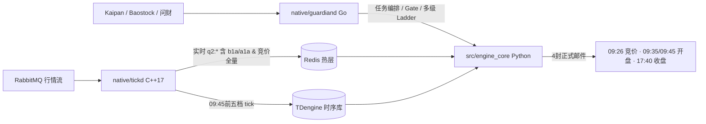

<div align="center">

# ⚙️ engine_core (`v1.0.0`)

### **实时盘口采集 · 工作流编排 · 竞价/开盘/收盘决策报告一体化 Monorepo**

`REDIS + TDENGINE`　·　`MISSING ≠ ZERO`　·　`NO LOOK-AHEAD`　·　`SEAMLESS DEGRADATION`

</div>

---

## 1. 系统定位与总体架构

`engine_core` 是 A 股日内短线与题材演化的全链路生产系统（单仓 Monorepo），由三大核心组件组成：



| 组件 | 路径 | 语言 | 职责 |
|---|---|---|---|
| **实时行情采集端** | `native/tickd/` | C++17 | 消费 RabbitMQ 原始五档行情，实时写入 Redis `q2:*`（含一档盘口金额 `b1a`/`a1a`、大单净额、涨速、竞价锚点）与全量竞价视图 `core:auction:full:*`，并在 `09:45:59` 前落盘五档 tick 至 TDengine `market_data1.stock_tick_v2` |
| **工作流调度守护进程** | `native/guardiand/` | Go | 原生交易日任务编排器：支持开机初始化链、9 种前置 `gate`、DAG `depends_on`、`catchup`/`late_until` 迟到回补、指数退避、盘后重型任务 `cost=heavy` 负载退让（`heavy_max_load5`），以及多级 `ladder` 自动降级 |
| **核心计算与报告引擎** | `src/engine_core/` | Python 3.12 | 全链路数据管道、盘中涨停池实时真封单/开板风险判定、竞价 V3 全景报告、开盘极简确定性快报、收盘复盘报告与邮件投递 |

---

## 2. 仓库目录结构

```text
engine_core/
├── src/engine_core/          # Python 核心引擎、数据管道、报告渲染与邮件投递
│   ├── data_pipeline/        # 去 catalog 数据存取、B4 契约校验、日K/涨停池/热板 provider
│   ├── guardian/             # 任务命令构造、门禁校验、盘前健康检查、多收件人分流
│   ├── auction_panorama*.py  # 09:26 竞价 V3 全景计算与 2D 题材连板矩阵渲染
│   ├── email_board.py        # 09:35/09:45 极简确定性开盘快报（~9KB 一屏）与收盘看板
│   ├── close_review.py       # 17:40 收盘复盘推导（含热板象限演化与开盘检查点追踪）
│   └── q2.py                 # Redis q2:* 实时行情适配（含 b1a/a1a 一档挂单金额）
├── native/
│   ├── guardiand/            # Go 原生任务编排器源码与配置生成工具
│   └── tickd/                # C++17 实时行情采集与盘口计算引擎
├── examples/                 # 生产入口脚本（guardian_handler.py / run_daily_reports.py 等）
├── tests/                    # 单元与真实数据契约回归测试
└── docs/                     # 架构说明（ARCHITECTURE.md）与专题技术文档
```

---

## 3. 生产存储规范（已全面去 `catalog`）

- **热态与实时数据 → Redis**：
  - `q2:<symbol>`：全市场 5,200+ 只股票实时快照（含 `b1a` 买一金额元、`a1a` 卖一金额元、涨跌停状态 `ls`、`spd1m`/`amt2m`/`ln`）
  - `core:auction:full:<date>:<0920|0924|0925>`：全量竞价定点视图
  - `core:cache:data:hot_plates:<date>:*`：开盘啦全天多时点热板快照
  - `core:cache:data:limit_up_pool_today:<date>:*`：盘中涨停池（含实时 `seal_amount`、`ask1_amount`、`seal_status`: `SEALED / OPEN_RISK / EMPTY_BOOK`）
  - `core:view:limit_up_pool:<date>` / `core:view:plate_stock_index:<date>`：昨日涨停池与板块映射视图
- **历史与盘后时序数据 → TDengine**：
  - `core_data.daily_kline_v1`、`daily_dde_v1`、`price_volume_indicators_v1`、`chip_indicators_v1`、`dde_indicators_v1`、`adjust_factor_v1`
  - `market_data1.stock_tick_v2`（`09:15–09:45:59` 五档逐笔）
  - `cold_*`：异步冷归档表
- **静态参考资产**：允许使用规范化 CSV；生产链路禁止读写旧 `catalog.json`。

---

## 4. 每日 4 封核心生产报告

| 时点 | 阶段 | 体积 | 核心定位 |
|---|---|---|---|
| **09:26** | 竞价全景 V3 | ~62 KB | 热点题材竞价分桶、2D `连板天数 × 题材` 色块矩阵、资金去向雷达与风格分布 |
| **09:35** | 开盘极简初验 | ~9 KB | 10 秒一屏确定性快报：大环境抛压定性 + 🔥真进攻主线 Top5 + 🩸放量失血避坑 + 硬封/开板/跌停（去ST带封单额）+ 急拉与砸盘避坑 + 核心高标 |
| **09:45** | 开盘极简终验 | ~9 KB | 同上，开盘 15 分钟终局确认 |
| **17:40** | 收盘复盘 | ~30 KB | 全天大盘、竞价与开盘检查点追踪、243 板块热板象限演化、连板晋级与昨日机会回看 |

> **收件人隔离**：正式报告支持在 `guardiand` 配置的 `email_to` 中配置多收件人；所有测试、模拟演练（`--simulate-clock`）、告警（`Core [ALERT]`）与夜间报告强制仅发送给管理员单人邮箱。

---

## 5. 工作流级无感降级（`tickd DEAD` 容灾）

基于 `guardiand` 原生多级 `ladder`（`rung 0` 失败/超时自动切 `rung 1` 并传 `degrade_requested=true`），在数据适配层实现**下游渲染无感替换**：

| 阶段 | 主链（`rung 0`） | 断源自动降级（`rung 1`） |
|---|---|---|
| **09:26 竞价** | `core:auction:full:0925` (`require_live_data=true`) | 问财竞价兜底 → 无感适配为标准 `facts_rows`，复用同一套 V3 竞价报告 |
| **09:35 / 09:45 开盘** | `live_q2 + hot_plates` (`require_live_data=true`) | 纯开盘啦热板进攻主线 + 昨日高标（不依赖 `tickd`） |
| **盘中涨停池** | Redis `q2:*`（实时 `b1a/a1a`） | 关键节点（`10:10 / 11:25 / 14:30 / 15:20`）自动切问财（受日预算与限频约束） |
| **15:05 / 17:40 盘后** | `Baostock → WenCai → Q2FinalProvider` | 天生不依赖 `tickd`，受 `cost=heavy` 与 `heavy_max_load5` 错峰退让保护 |

---

## 6. 构建、测试与运维速查

### Python 核心测试
```bash
PYTHONPATH=src:. /home/exedev/services/engine-next/shared/venv/bin/python -m pytest -q \
  tests/test_q2_adapter.py tests/test_limit_up_today.py tests/test_email_board.py \
  tests/test_auction_panorama_view.py tests/test_daily_pipeline.py
```

### 编译与自检 `native/tickd`（C++17）
```bash
cd native/tickd
CORE_DATA_ROOT=/home/exedev/core-data bash make.sh --self-test --out=build/tickd
```

### 校验与重启 `guardiand`
```bash
# 校验配置
/home/exedev/core-data/guardian-native/guardiand validate /home/exedev/core-data/guardian-native/config.json

# 平滑重启（由 supervisor.sh 5 秒后自动拉起并加载新 config_version）
kill -TERM "$(pgrep -x guardiand | head -n 1)"
```

更多架构细节与线上目录拓扑见 [docs/ARCHITECTURE.md](docs/ARCHITECTURE.md) 与 [native/tickd/README.md](native/tickd/README.md)。
