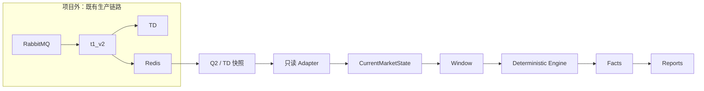
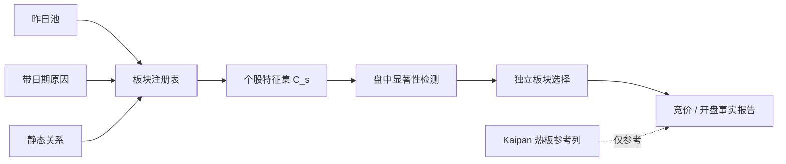
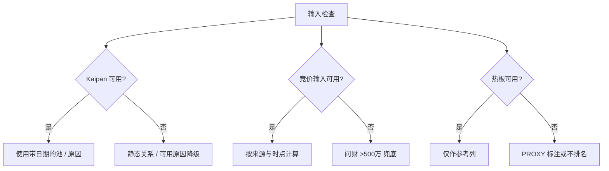

<div align="center">

# ⚙️ engine_core

### **事实先行 · 确定性计算 · 只读接入**

独立的行情驱动计算内核：把有时点的数据转成可追溯的竞价与开盘事实。

`MISSING ≠ ZERO`　·　`NO LOOK-AHEAD`　·　`READ-ONLY CORE`

</div>

> 本项目只读真实数据与封存文件。RabbitMQ → t1_v2 → TD/Redis 的生产链路在项目之外；Core 不接管 Rabbit ACK，不写 TD/Redis，不执行正式 effect。

## 导航

[定位与数据流](#数据流) · [分析流水线](#板块与个股分析流水线) · [模块地图](#模块地图) · [时点与来源](#数据源与时点) · [状态](#状态看板) · [快速开始](#快速开始) · [目录](#目录结构) · [路线图](#路线图) · [贡献与验证](#贡献与验证)

## 数据流



Core 的计算边界从已读取或封存的输入开始。事件时间、读取时间与到达时间各自保留；确定性回放只证明对应输入上的可重复性，不代表生产批次或输入保真度等价。

## 板块与个股分析流水线



输出用于描述观察到的事实与质量状态。显著性、C_s 分类与板块选择不自动构成交易建议；Kaipan 热板目前仅作为参考列。

## 降级矩阵



| 缺失环节 | 处理方式 | 解释 |
|---|---|---|
| Kaipan 池 / 原因 | 可用的静态关系、带日期原因 | 保留来源与时点；缺少时不补造成员 |
| 竞价输入 | 问财竞价金额大于 500 万兜底 | 兜底数据单独标来源，不冒充 Q2 / TD |
| 热门板块 | 标为 `PROXY` 或不排名 | 热板不是核心分析输入 |

## 核心原则

- **确定性与无未来函数：** 结论只使用结论时点之前可用的输入；盘后事实只用于结果核验。
- **缺失保持缺失：** 不把 `None`、不可用或未知静默填成零。
- **来源保持可见：** 同一引擎不代表输入保真度相同；事实与策略结论分开。
- **边界解耦：** `src/engine_core` 不依赖 `examples` 或旧系统源码；旧系统适配边界放在 `examples/legacy_adapters.py`。
- **竞价语义明确：** 09:25 前是虚拟撮合状态，不是成交量/成交额；真实成交量与成交额从 09:25 后出现。

## 模块地图

| 模块 | 职责 |
|---|---|
| `engine.py` / `state.py` | 确定性信号队列、reducer 与当前市场状态 |
| `q2.py` | Redis Q2 投影的薄适配与字段归一化 |
| `windows.py` / `timers.py` | 半开时间窗与定时器原语 |
| `auction.py` / `opening.py` | 已观测竞价字段与开盘事实的纯计算 |
| `plate_registry.py` / `plate_membership.py` | 板块注册表、多成员关系与层级事实 |
| `plate_significance.py` | 单横截面稳健板块显著性检查 |
| `plate_aggregation.py` / `plate_strength.py` | 不含策略结论的板块竞价与开盘聚合事实 |
| `data.py` / `live_inputs.py` | 查询数据边界与输入结果封装 |
| `reporting.py` / `report_render.py` | 冻结事实的报告投影与渲染 |
| `replay.py` / `replay_frames.py` / `replay_arrival.py` | 回放与输入保真度相关工具 |

## 数据源与时点

| 输入 | 用途 | 时点规则 |
|---|---|---|
| Redis Q2 投影 | 实时影子读取、竞价与开盘状态 | 保留源时间戳与读取时间；09:25 前不当作成交 |
| TD 竞价快照 | 历史竞价行与摘要重建 | 按冻结行自身时间聚合；不推断 Rabbit 到达顺序 |
| Kaipan 池 / 原因 | 昨日池、原因与板块层级 | 使用 `Date < D` 的原因构造 D 日盘前输入 |
| 静态板块关系 | 个股与板块映射 | 记录快照时点；未知时点不得宣称 point-in-time |
| 问财竞价兜底 | 竞价输入缺失时的有限补充 | 仅按日期查询，标记来源；阈值为金额大于 500 万 |

## 状态看板

| 项目 | 状态 |
|---|---|
| TASK-008 | `PARTIAL_EVIDENCE` |
| REPLAY_FOR_DEVELOPMENT | `USABLE_WITH_LIMITS` |
| NORMAL_OPENING_ACCEPTANCE | `UNPROVEN` |
| M3_1_NORMAL | `BLOCKED` |
| TD_WRITE_HEALTH | `UNPROVEN` |

以上为当前证据边界，不因 README 更新而改变。

## 快速开始

在仓库根目录运行离线测试与最小垂直切片：

```bash
PYTHONDONTWRITEBYTECODE=1 PYTHONPATH=src:. python -m pytest tests -q -p no:cacheprovider
python examples/run_vertical_slice.py
```

| 常用脚本 | 用途 |
|---|---|
| `examples/run_vertical_slice.py` | 本地最小垂直切片 |
| `examples/run_fact_vertical_slice.py` | 事实计算垂直切片 |
| `examples/run_q2frame` 系列 | 封存 Q2Frame 回放与审计 |
| `examples/run_offline_plate_auction_open_report.py` | 离线板块竞价 / 开盘报告 |
| `examples/run_wencai_fallback.py` | 调用方提供网络函数的问财兜底入口 |

示例脚本的参数与输入边界以脚本 `--help` 和各自说明为准。默认测试使用离线 fixture，不等同于在线数据源验证。

## 目录结构

```text
src/engine_core/   计算内核、适配合同、事实与报告
examples/          有界回放、只读探针、离线构建与报告脚本
tests/             单元、合同与 fixture 测试
docs/              项目知识、任务文档与证据索引
plate/             板块关系与字典数据
```

## 路线图

| 已完成 | 进行中 | 待办 / 未证 |
|---|---|---|
| 确定性内核基础、Q2 / TD 只读适配、事实与报告轮子 | 盘中板块显著性、C_s 分类与独立板块选择 | NORMAL opening 验收、Rabbit 到达与批次保真度、TD 写入健康 |
| 冻结输入回放与有限真实数据对照 | 竞价与开盘事实输出迭代 | 完整策略迁移与正式 effect（不属于首期） |

## 贡献与验证

建议流程：**最小 patch → 针对性单测 → 最短可触发的真实窗口 → 证据复核 → 提交**。发布里程碑才运行全量回放；日常改动优先使用短窗口。每项结论注明输入、时点、来源与限制，状态标签只由证据维护流程更新。

提交格式：`type(scope): summary`；常用类型为 `feat`、`fix`、`test`、`docs`、`chore`。

## 历史说明

迁移过程与各验证入口的详细背景已完整归档至 [docs/README_HISTORY.md](docs/README_HISTORY.md)。
